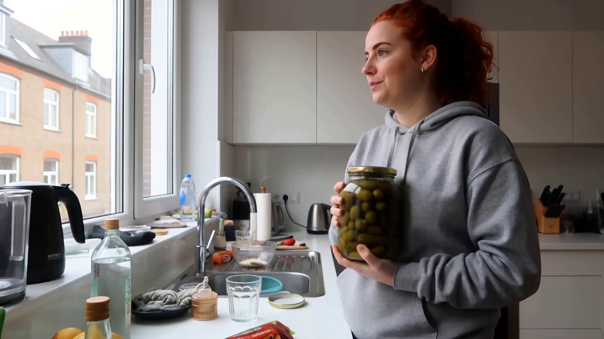
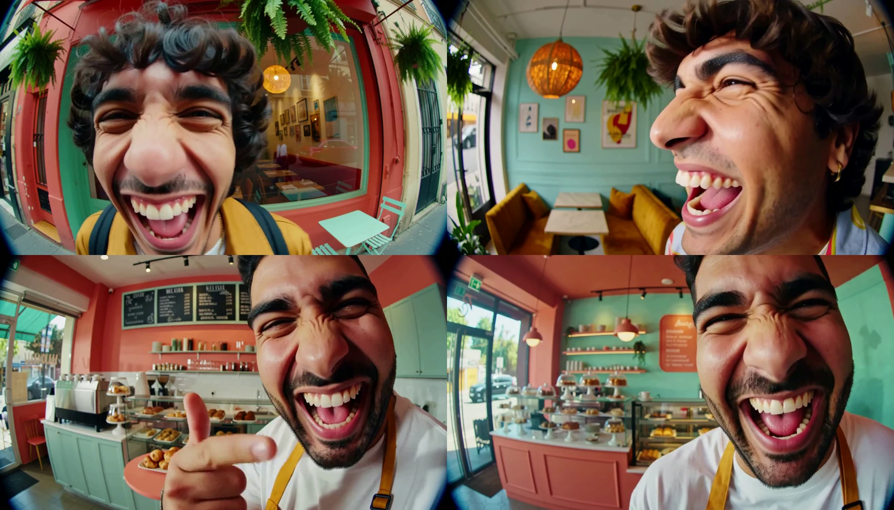
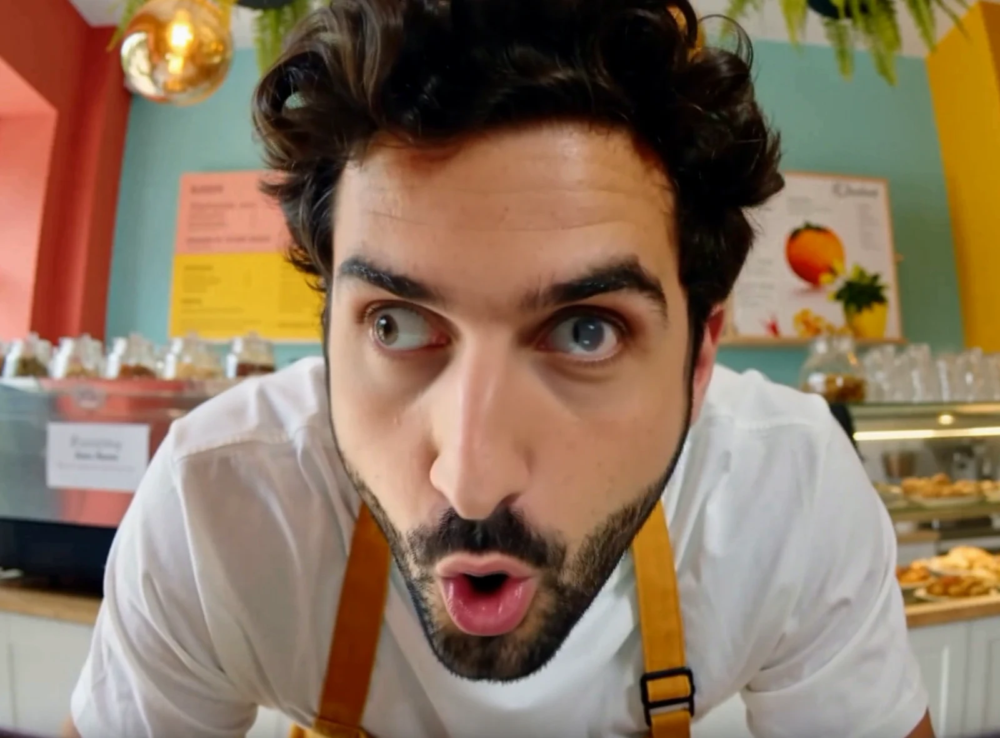
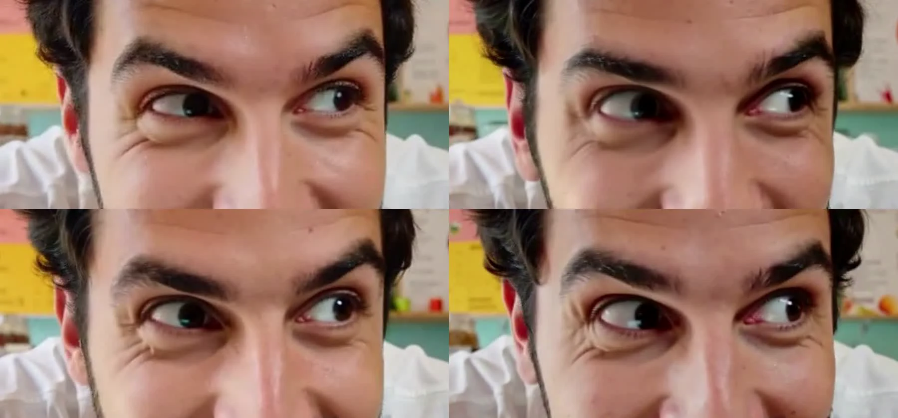
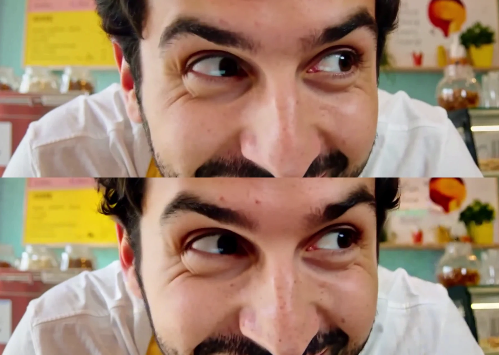

# SyncTile for MiniMax H3

[](https://doi.org/10.5281/zenodo.23196934)

**Seam-free 1080p, 2K and 4K for local MiniMax H3 video, through synchronized tiles. A ComfyUI node, a ready workflow and a scene-file pipeline, on one RTX 4090.**



MiniMax H3 is an open-weights video model that also generates sound. On a 24 GB card it tops out around 1344 x 768. SyncTile takes that clip up to 4K (3840 x 2160). The MiniMax H3 latent upscaler enlarges the latent. Then overlapping tiles refine it, and their latents are **blended after every sampling step**. One decode makes the video. You get no seams, and the eyes agree between tiles.

## The current version is 0.3.0

This repository started in October 2026 with one script, `synctile_h3.py`. Since then the work moved on. The tile step is now a ComfyUI node, and a full pipeline, SyncTile Studio, is built around it. **If you want to use SyncTile today, use the current version.**

| | First version (0.1) | Current version (0.3.0) |
|---|---|---|
| How you use it | One script | The `SyncTileRefine` node with a ready workflow, or SyncTile Studio |
| What you give it | A text prompt | Your own video (node) or a JSON scene file (Studio) |
| Sizes | 4K | 1080, 2K and 4K. Studio also makes 720 |
| Tile step | Three steps with the 8-step turbo LoRA | One step, no LoRA |
| Time of the 4K pass, 5 s clip | About 9 minutes | About 3.5 minutes |
| Faces | No extra pass | Eye pass at 720 and 1080, face and motion pass at 2K and 4K |
| Last step at 4K | Unsharp mask | RTX Video Super Resolution quad pass (horizontal 4K, in Studio) |
| Length | One clip, tested at 5 seconds | Many shots with reference images, or one 30 second take. The node refines a 30 second clip in time windows |

The two times come from different clips on the same RTX 4090. Read them as a guide.

**You have an older copy?** If you cloned this repository before 17 November 2026, go to its folder and run `git pull`. Then you have the current version.

The first version is not gone. Its script, its clips and its measurements are in [The first version](#the-first-version-01) and in [Results](#results).

## Examples

These videos come from the current version. The image at the top of this page is one frame from the 4K example. The videos are release files. Each video comes from one scene file in `examples/`, with no edit after the render.

| Video | Scene file | What it shows |
|---|---|---|
| [Pickle jar, 4K with RTX](https://github.com/alaintural/synctile-h3/releases/download/v0.2.0/pickle-jar-4k-rtx.mp4) (30 MB) | `examples/demo_pickle_4k.json` | One shot at 3840x2160: SyncTile, the face and motion pass, then the RTX quad pass. |
| [Pickle jar, 4K](https://github.com/alaintural/synctile-h3/releases/download/v0.2.0/pickle-jar-4k.mp4) (20 MB) | `examples/demo_pickle_4k.json` | The same run before the RTX quad pass. |
| [Pickle jar, 1080](https://github.com/alaintural/synctile-h3/releases/download/v0.2.0/pickle-jar-1080.mp4) (4 MB) | `examples/demo_pickle.json` | One shot at 1920x1080: SyncTile and the full-frame eye pass. |
| [Coffee, single take, 720](https://github.com/alaintural/synctile-h3/releases/download/v0.2.0/coffee-single-take-720.mp4) (20 MB) | `examples/demo_coffee_take.json` | One 30 second take from three blocks at 1280x720. No SyncTile and no eye pass. |

Download a video to see it at full quality. The browser player of GitHub can scale it down.

## What is in this repository

| You want | Use | Read |
|---|---|---|
| SyncTile in ComfyUI, on your own video | The `SyncTileRefine` node and a ready workflow | [ComfyUI node and workflow](#comfyui-node-and-workflow) |
| A full video from a scene file: shots, people, reference images, 720 to 4K | SyncTile Studio | [SyncTile Studio](#synctile-studio) |
| The first script (fast mode and 4K from a text prompt) and the measurements | `synctile_h3.py` | [The first version](#the-first-version-01), [Results](#results) |

## ComfyUI node and workflow

You do not need Studio to use SyncTile. The tile step is one ComfyUI node, and a ready workflow comes with it. You give it a video. It gives you the same video at 1080, 2K or 4K.

**Install**

1. Go to `ComfyUI/custom_nodes`.
2. Run `git clone https://github.com/alaintural/synctile-h3`.
3. Restart ComfyUI.

No git? Copy `comfy_node_synctile.py`, `comfy_node_stream_save.py`, `comfy_node_vae_settings.py` and `comfy_node_pipe_save.py` into `ComfyUI/custom_nodes`. The result is the same.

You get four nodes: `SyncTileRefine`, `SyncTileStreamSave`, `H3VAEAyar` and `H3BoruKaydet`. You also need the MiniMax H3 core nodes, `MinimaxH3LatentUpscaler3D` (Comfyui_Minimax_h3_latent_Upscaler) and these models: `minimax_h3_fl2va_pruned_int8_convrot`, the text encoder, the video VAE, the audio VAE and the latent upscaler.

The workflow uses these file names. Change them in the loader nodes if yours are different:

- `minimax_h3_fl2va_pruned_int8_convrot.safetensors` (20 GB)
- `qwen3vl_32b_minimax_h3_nvfp4_awq.safetensors` (text encoder)
- `minimax_h3_video_vae_int8_convrot.safetensors`, `minimax_h3_audio_vae_fp32.safetensors`
- `minimax_h3_latent_upscaler_3d_conv_v1_bf16.safetensors`

**Which H3 model?** The workflow uses the int8 file (20 GB). You can also select `minimax_h3_fl2va_pruned_bf16.safetensors` (38 GB) in the model loader. We compared the two in this step at 1080 and at 4K, with one scene. We saw no difference. The bf16 file took 26% to 60% more time and 10 to 28 GB more RAM.

**Use the workflow**

1. Drag `workflow_synctile_upscale.json` into ComfyUI.
2. In "Load Video", select your video. It must have an audio track.
3. In the H3 prompt node, describe the video: the look of the footage, the place, the people and what they do.
4. In the latent upscaler node, set the size.
5. Run.

| size | width x height | tiles | time for a 5 s clip on our GPU |
| --- | --- | --- | --- |
| 1080 | 1920 x 1088 | 4 | about 2 minutes |
| 2K | 2560 x 1440 | 4 | about 2 minutes |
| 4K | 3840 x 2160 | 9 | about 3.5 minutes |

`workflow_synctile_upscale_api.json` is the same workflow in API format, for scripts.

**What the workflow does**

1. It scales the video to 1344x768 and encodes it.
2. The latent upscaler brings the latent to your size.
3. `SyncTileRefine` cuts the latent into tiles that overlap, adds one shared noise and samples each tile for one step. After every step it blends the tiles in latent space. That is why you see no seams.
4. `SyncTileStreamSave` decodes the latent and writes the mp4 at the same time. The audio of your video is copied.

**Inputs of `SyncTileRefine`**

| input | meaning |
| --- | --- |
| `guider` | `BasicGuider` with the H3 model and your prompt |
| `sampler` | `KSamplerSelect`, "euler" |
| `sigmas` | `ManualSigmas`, "0.45, 0". The first number is the strength. We use and tested one step |
| `video_latent` | the latent from the latent upscaler |
| `audio_latent` | the audio latent of the same clip. H3 is an audio-video model, so it needs one. The audio is not changed |
| `tile_width`, `tile_height` | 1472 x 896 for horizontal video |
| `seed` | noise seed |
| `window_frames` | optional, for long clips: the length of one time window in frames (124, 141 or 243). 0 = off |
| `window_overlap` | frames that two neighbour windows share (22, 39 or 56). 39 is the default |

With the same input, the node gives the same latent as `synctile_4k.py` in Studio. We compared the two: the difference is 0.

**Good to know**

- Tested with 5 second clips (124 frames, 24 fps), horizontal, at the sizes in the table. Long clips: see [Long clips and less memory](#long-clips-and-less-memory).
- For vertical video, swap width and height in three nodes: the image scale (768 x 1344), the tiles (896 x 1472) and the upscaler size. We did not test this in the node.
- The width, height and length of the H3 prompt node are not used here. Only the text counts.
- The workflow has no eye pass, no face and motion pass and no RTX step. Those are in Studio.
- Studio gives the latent of the base render to the tile step. The workflow starts from a video file, so a little detail is lost on the way in.

## Long clips and less memory

New in 0.3.0. Two changes let the node work on a 30 second clip, and on a card with less VRAM.

**Time windows.** Set `window_frames` in `SyncTileRefine`. The node then also cuts the clip on the time axis. Each window is refined alone, and the windows are blended after every step, the same way as the tiles. VRAM use does not grow with the length of the clip. The audio of each window is the audio of the same seconds.

- Use a clip of 17k+5 frames (for example 124, 362 or 719 frames at 24 fps). If the length is different, the node tells you the nearest good length.
- We use `window_frames` 124 and `window_overlap` 39.

**Streamed save.** `VAEDecodeTiled` keeps all decoded frames in RAM as float32. For a 30 second 1080 clip, our ComfyUI process used 93 GB of RAM. `SyncTileStreamSave` gives the H3 VAE an output that sends each finished part to ffmpeg. RAM use then does not grow with the length of the clip. The workflow uses this node.

| test (RTX 4090, 1920 x 1088, int8 model) | frames | time | ComfyUI RAM |
| --- | --- | --- | --- |
| 15 s, windows 124 / 39, streamed save | 362 | 380 s | about 53 GB |
| 30 s, windows 124 / 39, streamed save | 719 | 580 s | about 62 GB, no growth during the decode |
| 30 s, windows 124 / 39, `VAEDecodeTiled` | 719 | 880 s (with model load) | 93 GB |

Most of the RAM in this table holds the models. The 15 s output of `SyncTileStreamSave` and of `VAEDecodeTiled` differ by 41.8 dB PSNR. Both files are lossy mp4, so this is not proof that the frames are the same.

**A 10 to 12 GB VRAM budget.** We started ComfyUI with `--reserve-vram 14` on our 24 GB card and used tiles of 768 x 448. A 15 s 1080 clip with time windows then finished in 460 s, and ComfyUI used about 11 GB of VRAM. We did not test this on a real 12 GB card.

## SyncTile Studio

SyncTile Studio turns a JSON scene file into a MiniMax H3 video. It runs on a local ComfyUI.

The pipeline has these steps:

1. **Base.** The H3 Continuity extension renders all shots at 1344x768 (25 steps, with reference images).
2. **SyncTile.** For 1080, 2K and 4K, the base latent goes through the MiniMax H3 latent upscaler. Then synchronized tiles refine it in one step. The decode is one tiled VAE decode.
3. **Eye pass.** An optional second pass with the identity references at low denoise (0.2, 8 steps). At 720 and 1080 it runs on the full frame. At 2K and 4K it is a face and motion pass: each face and the box with the most motion are cropped, processed at 1280x1280 and laid back over the frame.
4. **Assembly.** Crop, cut, audio tail (L-cut) and concat with ffmpeg. Horizontal 4K also gets an RTX Video Super Resolution quad pass.

The example videos are in [Examples](#examples).

### Use

```
python studio.py examples/single_shot.json --dry     # print the prompts only
python studio.py examples/single_shot.json           # render
```

Requirements, setup, the scene file, the modes and the limits are in [STUDIO.md](STUDIO.md).

### Status

Studio is a research release. The code is the code we use on one Windows machine with one RTX GPU. We did not test it on Linux or macOS. Read "Limits" in `STUDIO.md` before you use it.

## What SyncTile adds

Tiled upscaling is not new. MultiDiffusion (Bar-Tal et al., 2023) showed that diffusion tiles stay coherent if they are fused at every denoising step, and the MiniMax H3 community already has tiled upscalers (MMH3 Split Upscale). What this repo adds:

1. **Per-step synchronization on MiniMax H3's joint audio-video latent.** Each tile runs one sampling step at a time through ComfyUI. After every step all tiles are blended with linear overlap weights in latent space and the next step starts from the shared result. The GPU only ever holds one tile.
2. **One shared noise image for the whole canvas**, cut per tile, so overlaps start identical.
3. **Latent upscaling instead of pixel upscaling as the input**, and **one decode of the full canvas**, so there is no pixel seam to hide.
4. **Measured, including what did not work** (below), plus a shimmer metric that matched what we saw in playback when a standard sharpness score did not.

The diagram shows the first version: three steps, from sigma 0.878. The current version does the same in one step, from sigma 0.45.

```
fast clip 1344x768 ──VAE──> latent ──MiniMax H3 latent upscaler──> 4K latent (3840x2160)
                                                                        │ + shared noise at sigma 0.878
        for step in 6..8:                                              ▼
            for each of 9 tiles (one at a time):  MiniMax H3, 1 step ──> tile latent
            blend all 9 tiles (overlap ramps) ──> canvas latent        (tiles agree before the next step)
                                                                        ▼
                                            decode once ──> 4K video ──> light unsharp mask (optional)
```

## Results

We made these measurements in October 2026 with the first version (`synctile_h3.py`). They show why the method works. All numbers on one RTX 4090, same prompts and seed. Details and caveats are in the [write-up](https://pixedi.com/lab/minimax-h3-4k-synctile).

### Speed (1344 x 768, 141 frames)

| Setup | Time | Speed-up | SSIM motion / face |
|---|---|---|---|
| 25 steps, no speed-up | 562 s | 1.00x | reference |
| EasyCache 0.20 | 325-369 s | 1.5-1.7x | 0.85 / 0.96 |
| LazyCache 0.20 | 346-391 s | 1.4-1.6x | 0.85 / 0.96 |
| TeaCache 0.25 | 195 s | 2.9x | 0.58 / 0.75 (composition drifts) |
| int8 attention | 304-307 s | 1.85x | 0.70 / 0.91 |
| 8-step LoRA | 199 s | 2.8x | own reference |
| **8-step LoRA + int8 attention** | **114-117 s** | **4.9x** | 0.69 / 0.92 vs 8 steps |
| SageAttention 2.2 | 1,127 s | 0.5x | bit-identical output |


### Holding tiles together (2688 x 1536, 5 s)

| Method | Time | Result |
|---|---|---|
| Four quarters generated separately | 406 s | Four different scenes |
| Four tiles, each finished on its own | 430-438 s | Moving objects shift, eyes can disagree |
| + fifth tile over the seams | 541-550 s | Fixes the center only, slowest |
| + frequency lock | 430-438 s | Double edges on moving objects |
| **SyncTile (per-step sync)** | **243-272 s** | No seam, eyes agree |








### 4K routes compared (same base clips, 5 s, café / drone)

| Route | Time | Fidelity to base (SSIM) | Shimmer (plain resize ≈ 1.5) |
|---|---|---|---|
| **SyncTile** | **542 / 549 s** | 0.87 / 0.81 | **1.62 / 1.60** |
| MMH3 Split Upscale | 605 / 601 s | 0.84 / 0.79 | 1.68 / 1.66 |
| SeedVR2 7B (block swap) | 2,097 / 2,085 s | 0.96 / 0.95 | 3.00 / 2.45 |

*Shimmer* = mean frame-to-frame change of the finest detail layer (frame minus Gaussian blur, sigma 2) on a full-resolution 1024 px center crop. SeedVR2 looked sharpest on single frames and scored highest on Laplacian sharpness, but its texture boiled in playback; the shimmer score caught that. Split Upscale gave more fine texture and shifted the face slightly. SeedVR2 ran out of memory at 4K with default settings on 24 GB.



The optional last step, an unsharp mask (5 x 5, amount 1.0), was matched to a manual sharpening pass in an editor: fine detail +27%, shimmer 2.1.

## The first version (0.1)

This is how SyncTile looked in October 2026. We keep it because the measurements in "Results" come from it, and because the script still works.


- It was one script, `synctile_h3.py`, with two modes: `fast` (8-step LoRA and int8 attention, 562 s -> about 115 s) and `4k`.
- A 5 second 4K clip took about 11 minutes: about 2 for the fast clip and about 9 for the tile pass.
- It made one clip from a text prompt. It had no node, no pass for faces and no RTX step.

The current version changed all three points. For new work, use the node or Studio.

### Clips of the first version (original files, open full screen)

| Clip | What to look at |
|---|---|
| [Drone canyon, 3840 x 2160](https://github.com/alaintural/synctile-h3/releases/download/v0.1.0/drone-canyon-4k-synctile.mp4) (51 MB) | Fast camera move, kayaker crossing the tile seams |
| [Café close-up, 3840 x 2160](https://github.com/alaintural/synctile-h3/releases/download/v0.1.0/cafe-closeup-4k-synctile.mp4) (22 MB) | Eyes, beard and skin across the seams |
| [Same café clip through MMH3 Split Upscale](https://github.com/alaintural/synctile-h3/releases/download/v0.1.0/cafe-closeup-4k-split-upscale.mp4) | Compare face position and texture in motion |
| [SeedVR2 7B vs SyncTile, 1:1 crop](https://github.com/alaintural/synctile-h3/releases/download/v0.1.0/seedvr2-vs-synctile-crop.mp4) | Left SeedVR2, right SyncTile: texture shimmer |
| [25 steps vs 8 steps + int8](https://github.com/alaintural/synctile-h3/releases/download/v0.1.0/25-steps-vs-8-steps-int8.mp4) | 562 s vs 114 s, same seed |

### Quick start with synctile_h3.py

Requirements:

- ComfyUI recent enough to include the MiniMax H3 nodes, `ModelAttentionBackend` ("comfy kitchen attention") and the LTXV audio-video latent nodes
- Custom node [Comfyui_Minimax_h3_latent_Upscaler](https://github.com/LBH-123-AI/Comfyui_Minimax_h3_latent_Upscaler) and its 3D model in `models/latent_upscale_models`
- MiniMax H3 weights, text encoder, VAEs and the 8-step turbo LoRA (file names at the top of `synctile_h3.py`; edit them if yours differ)
- Python 3.10+ with `torch` and `safetensors` (`pip install -r requirements.txt`), and `ffmpeg`
- 24 GB VRAM for 4K (tested on an RTX 4090)

Start ComfyUI, then:

```bash
export COMFYUI_INPUT=/path/to/ComfyUI/input
export COMFYUI_OUTPUT=/path/to/ComfyUI/output    # ComfyUI's output folder (or its --output-directory)

python synctile_h3.py fast "A drone shot over a red-rock canyon at golden hour" --seconds 5
python synctile_h3.py 4k   "A drone shot over a red-rock canyon at golden hour" --seconds 5 --name canyon
python synctile_h3.py 4k   --prompt-file prompt.txt --sharpen 0      # no sharpening
python synctile_h3.py 4k   "A drone shot over a red-rock canyon at golden hour" --size 1920x1088   # 1080p
```

`--size WxH` sets the target of the SyncTile pass (default 3840x2160). Both sides must be multiples of 16. At 1920x1088 the canvas needs 4 tiles instead of 9: a 5 s clip took 200 s for the tile pass on an RTX 4090 (plus 104 s for the fast clip).

Output goes to `./synctile_output/`: the fast 1344 x 768 clip, the 4K clip, the sharpened 4K clip and a JSON log. Intermediate latents land in `<ComfyUI output>/synctile/_tmp/` and can be deleted.

### Limits of synctile_h3.py

- 4K was tested on 5-second clips (124 frames). Longer clips make every tile heavier and may not fit in 24 GB.
- MiniMax H3 length rule: 17n + 5 frames at 24 fps; `--seconds` is rounded.
- The 4K pass re-draws fine detail, so fast-moving objects can move a few pixels against the base clip. Fast water and mist stay as soft as in the base.
- Refining the last 4 of 8 steps instead of 3 took 2-4 minutes longer, added no visible detail and moved things slightly.
- `synctile_h3.py` is a script that drives ComfyUI's HTTP API. For a node, see "ComfyUI node and workflow".

## Safety

This list is about `synctile_h3.py`.

- Plain, readable Python. No compiled code, no network access except your own ComfyUI on localhost, no telemetry, nothing is downloaded.
- Only `.safetensors` latents are written and read; no pickle files.
- Writes only to ComfyUI's input and output folders and to `--out`.
- Tiles are processed one at a time, so peak VRAM equals one 1472 x 896 tile.

The `SyncTileRefine` node is also plain Python. It reads no files, writes no files and uses no network. Studio does more: it stops and starts ComfyUI, and it ships one ONNX file (the YuNet face detector).

## Model license

This repo contains no MiniMax H3 weights. The only model file here is the YuNet face detector (`face_detection_yunet_2023mar.onnx`, from the OpenCV Zoo, MIT license). Bring your own MiniMax H3 weights and check the MiniMax H3 license terms for your region and use case. The MIT license below covers this code, not the model.

## Credits

- MiniMax for releasing MiniMax H3
- ComfyUI and its MiniMax H3 / LTXV latent nodes
- MultiDiffusion: Bar-Tal, Yariv, Lipman, Dekel, *MultiDiffusion: Fusing Diffusion Paths for Controlled Image Generation*, ICML 2023
- [Comfyui_Minimax_h3_latent_Upscaler](https://github.com/LBH-123-AI/Comfyui_Minimax_h3_latent_Upscaler) (latent upscaler, MMH3 Split Upscale)
- [ComfyUI-MiniMaxH3-TeaCache](https://github.com/Icyoung/ComfyUI-MiniMaxH3-TeaCache): in our tests the step counter was not reset when the same settings ran twice, so the second run used no caching; resetting `state` when `step_idx >= total_steps` fixed it
- [pepikir/minimax-h3-speedup](https://github.com/pepikir/minimax-h3-speedup) for the EasyCache notes
- ComfyUI-H3-Continuity-Studio and ComfyUI-H3-Multishot: Studio uses them for the base pass and for single-take scenes
- OpenCV YuNet: the face and motion pass of Studio finds faces with it
- FreeNoise: Qiu et al., *FreeNoise: Tuning-Free Longer Video Diffusion via Noise Rescheduling*, ICLR 2024. The time windows use the same idea of windows that overlap and are blended

## Used by

- [NyckM/Bruxosdovfx-SyncTile-MiniMax-H3-v5.4](https://github.com/NyckM/Bruxosdovfx-SyncTile-MiniMax-H3-v5.4)
- [zeroleloushe/H3ZeroStudio](https://github.com/zeroleloushe/H3ZeroStudio)

## Citation

If SyncTile helps your work, please cite it (see `CITATION.cff`):

```
Tural, A. (2026). SyncTile for MiniMax H3: synchronized-tile 4K refinement and speed benchmarks (Version 0.3.0). Pixedi AI Lab. Zenodo.
https://doi.org/10.5281/zenodo.23196934
```

## License

MIT. Copyright (c) 2026 Alain Tural, Pixedi. See `LICENSE` and `CITATION.cff`.

Made by [Alain Tural](https://github.com/alaintural) at [Pixedi AI Lab](https://pixedi.com/lab).
